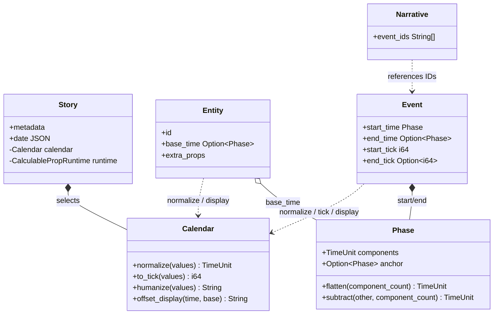
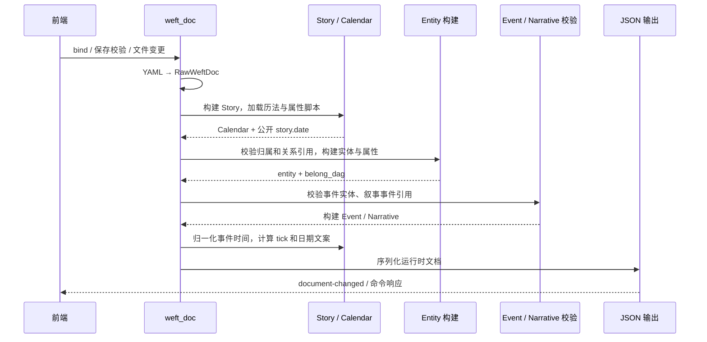

# 后端设计总览

本文从时间值的基础类型 `Phase` 开始，按依赖关系说明 Weft 后端的领域模型和运行时流程。内容描述当前 Rust 实现；YAML 字段与 Rune 脚本的完整输入规范仍以[数据格式](../weftdoc.md)和[插件接口](../rune-calendar.md)为准。

## 模块边界

- `weft_doc.rs` 是 YAML 文档边界：反序列化 Raw 类型、按阶段校验和构建，最后生成 JSON；同时负责绑定、保存校验及文件变更推送。
- `weft/phase.rs` 表达原始时间及相对偏移。它不包含具体历法规则。
- `calendar.rs` 持有已编译 Rune 历法，并统一提供归一化、tick 和日期文案接口。
- `weft/entity.rs`、`event.rs`、`narrative.rs` 构建领域数据、校验引用并生成前端需要的派生值。
- `calculable_prop.rs` 加载 story 声明的属性脚本，并在实体构建时产出 `extra_props`。

## 构建顺序

阶段顺序是有意的：Story 先准备历法和属性运行时；Entity 完成后才能验证事件参与实体；事件和叙事引用均通过后，最后才计算事件时间并输出。任一阶段失败都会返回文档错误，不产生可展示的新文档。

## 章节

- [Phase：时间表达](phase.md)：递归偏移、展平规则和历法边界。
- [Calendar：历法运行时](calendar.md)：Rune 接口、归一化、tick 与显示职责。
- [Entity：实体与关系](entity.md)：Raw/运行时实体、归属 DAG 与计算属性。
- [Event 与 Narrative](event-narrative.md)：事件派生时间数据和按序引用。
- [WeftDoc 生命周期](document-pipeline.md)：解析、保存、监听和语言刷新。
