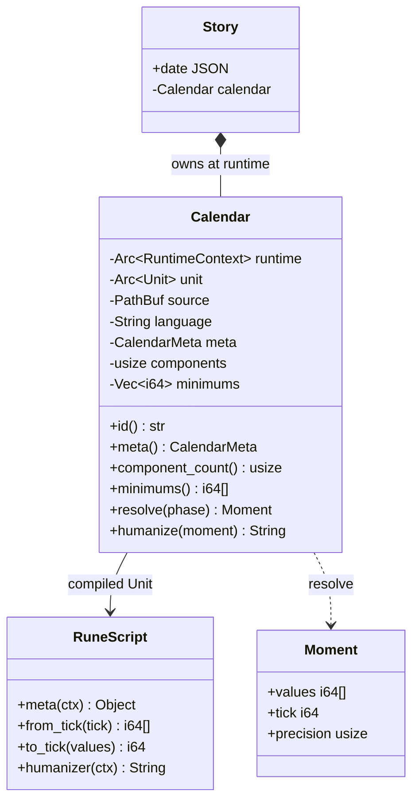
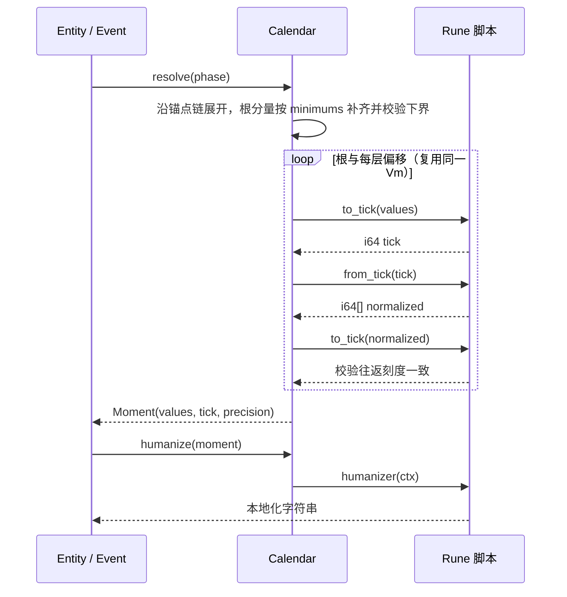

# Calendar：历法运行时

`src-tauri/src/calendar.rs` 将历法脚本封装成统一的 Rust 接口。`Story::from_raw` 根据 `story.date_mode` 加载自定义脚本，未填写时加载应用资源中的公历脚本。加载阶段读取并编译脚本（按 `(路径, 源码)` 缓存 `Arc<Unit>`），检查接口函数是否以 `pub` 定义，并调用 `meta(ctx)` 一次性获取历法 `id`、展示文案、分量数与各分量起始值。

## 统一时间流程

`normalize(values)` 固定实现为 `from_tick(to_tick(values))`，并核对 `to_tick(from_tick(tick)) == tick`。因此脚本的 `to_tick` 必须接收未归一化分量，并将进位、借位映射到可比较的 64 位整数；`from_tick` 必须返回准确的分量数。根时间缺省尾部分量时宿主按 `minimums` 补齐，非首位分量低于起始值或分量超长则拒绝。`humanize` 通过上下文对象把 `values`、`precision` 与当前 `zh` / `en` 语言传给脚本。

事件时间使用同一个 tick 域进行排序、起止先后校验和叙事线偏移；实体的基准时间在构建期只解析一次 `Moment`，同时用于生成展示文案与透传给可计算属性（含 `values`、`precision`、`tick`）。

## 插件隔离

历法脚本必须以 `pub` 函数实现 `meta`、`from_tick`、`to_tick`、`humanizer`（未被引用的私有函数不会进入 Rune 编译产物）。`meta(ctx)` 返回的 `id` 与 `name` 必须非空，`components` 须在 1 到 64 之间，`minimums` 长度须等于 `components`。宿主运行时上下文全局复用且不注入 io 模块，脚本限制文件大小，每次调用套指令预算；编译与运行错误均转为结构化文档错误。

`meta(ctx)` 产出的 `{ id, name, description }` 写入公开 `story.date`，其中 `id` 与 `components`/`minimums` 也一并交给 `CalculablePropRuntime`。应用切换语言时重新解析文档并刷新所有本地化文案。
