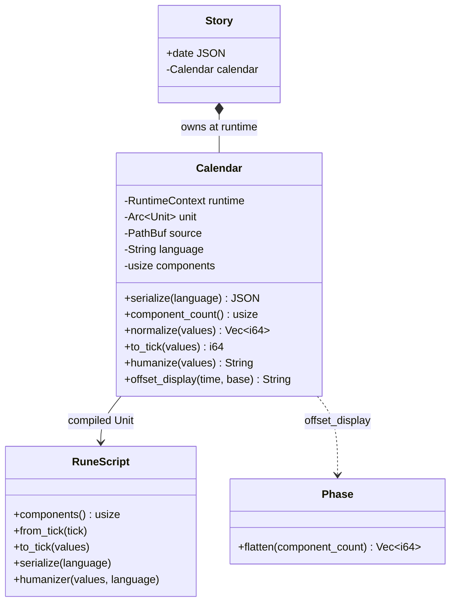
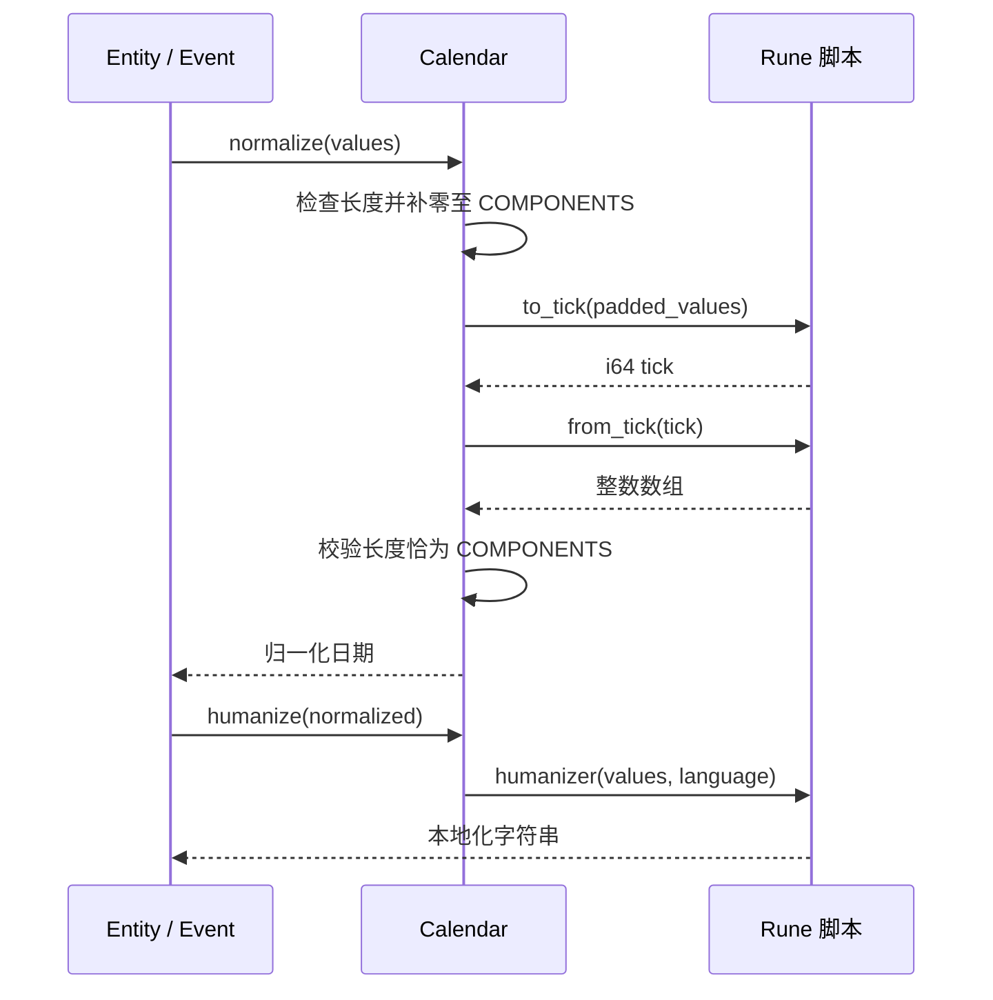

# Calendar：历法运行时

`src-tauri/src/calendar.rs` 将历法脚本封装成统一的 Rust 接口。`Story::from_raw` 根据 `story.date_mode` 加载自定义脚本，未填写时加载应用资源中的公历脚本。加载阶段读取并编译脚本，检查接口函数是否以 `pub` 定义，并调用 `components()` 取分量数。

## 统一时间流程

`normalize(values)` 固定实现为 `from_tick(to_tick(values))`。因此脚本的 `to_tick` 必须接收未归一化分量，并将进位、借位映射到可比较的 64 位整数；`from_tick` 必须返回准确的分量数。分量不足时宿主补零，超长则拒绝。`humanize` 只负责格式化，宿主把当前 `zh` / `en` 语言传入脚本。

事件时间使用同一个 tick 域进行排序、起止先后校验和叙事线偏移；实体的基准时间则保留原始 Phase，另行生成归一化日期及展示文案。`offset_display` 先对两个原始 Phase 做分量差，再用同一 Calendar 归一化并展示。

## 插件隔离

历法脚本必须以 `pub` 函数实现 `components/0`、`from_tick/1`、`to_tick/1`、`serialize/1`、`humanizer/2`（未被引用的私有函数不会进入 Rune 编译产物）；`components()` 返回 1 到 64 的分量数。每次调用的返回值都在使用点验证。宿主编译上下文不注入 io 模块，每次调用套指令预算，超限中断；脚本编译或运行错误会转为文档错误。

`serialize(language)` 的结果写入公开 `story.date`；编译后的 Calendar 保留在 Story 中但不序列化。应用切换语言时重新解析文档，重新构建运行时并刷新所有日期文案。
