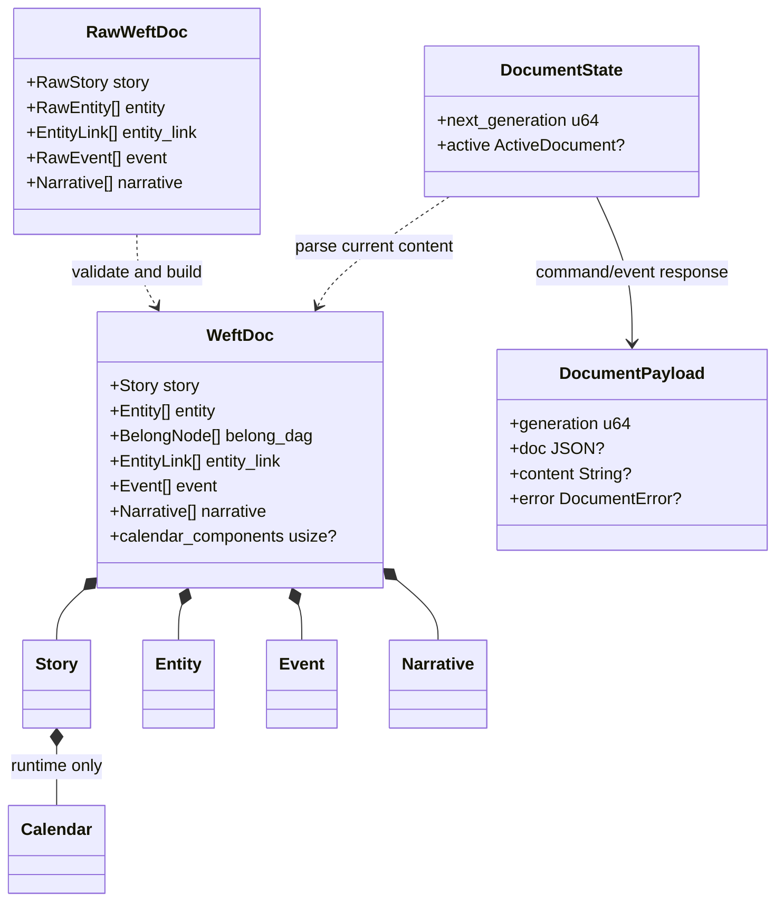
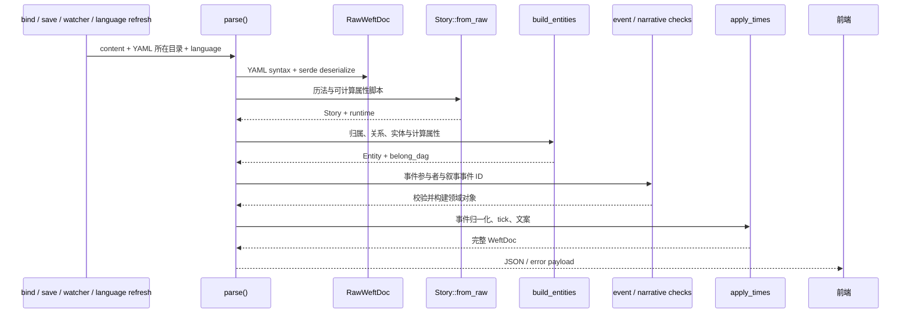

# WeftDoc：解析与文档生命周期

`src-tauri/src/weft_doc.rs` 是文档边界与应用命令实现所在模块。解析逻辑由 YAML 字符串生成运行时 `WeftDoc`，文件绑定、保存前校验、外部修改监听和语言切换都复用这条逻辑。

## 单一解析管线

反序列化忽略未声明的顶层键，实体未声明字段由 `flatten` 收入 `extra_props`。构建阶段依次为 Story、Entity、引用检查及事件构建；随后 `parse` 填入 `calendar_components`、计算事件时间并序列化 JSON。错误会阻断该次新文档输出。

## 文件与语言更新

- `bind_document` 在入口规范化目标路径（含符号链接目录与文件目标），先建立防抖 watcher（300 ms）再读取初始快照，避免绑定到监听生效间的漏事件窗口。监听范围覆盖文档所在父目录以及 YAML 中引用的外部 `.rn` 历法（`story.date_mode`）与可计算属性脚本（`story.calculable_props`）所在目录；事件过滤仅响应内容/路径变更与 `rescan`，忽略 `Access` 与纯元数据事件。
- 每次绑定分配单调递增的 `generation` 与提交序号 `seq`，并由 `DocumentPayload` 携带 `generation`；旧 watcher 回调在解绑或切换文档后立即停用，前端按 `generation` 丢弃迟到事件。
- `save_document` 先通过完整解析管线校验，再原子写入临时文件并 rename。`DocumentState` 记录最近一次已同步且校验通过的 YAML 文本，对主文档自身的重复事件与保存回声做幂等跳过；外部 `.rn` 脚本变更或 `rescan` 则无条件触发重新解析。
- 外部变更通过 `document-changed` 推送最新内容与解析结果；解析错误、文件删除与读取失败同样推给前端，避免旧视图被误认为新内容。
- 切换应用语言会重新读取当前文件并解析，以刷新历法与计算属性的本地化文案。
- `unbind_document` 停止并清除当前绑定与 watcher；前端初始化与卸载时会主动同步解绑，防止页面刷新后残留后端 watcher。
