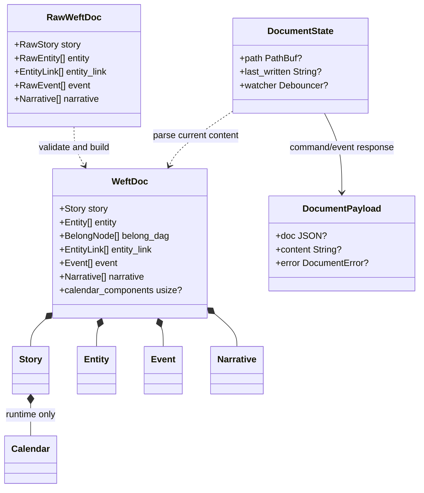
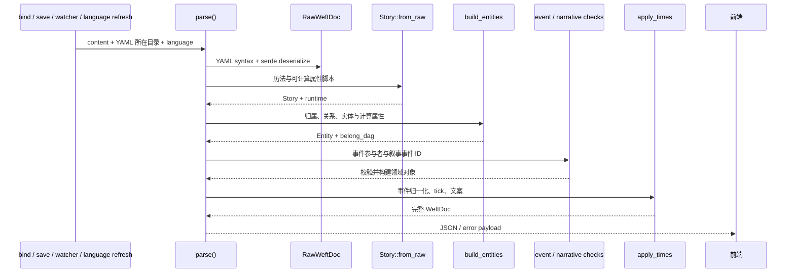

# WeftDoc：解析与文档生命周期

`src-tauri/src/weft_doc.rs` 是文档边界与应用命令实现所在模块。解析逻辑由 YAML 字符串生成运行时 `WeftDoc`，文件绑定、保存前校验、外部修改监听和语言切换都复用这条逻辑。

## 单一解析管线

反序列化忽略未声明的顶层键，实体未声明字段由 `flatten` 收入 `extra_props`。构建阶段依次为 Story、Entity、引用检查及事件构建；随后 `parse` 填入 `calendar_components`、计算事件时间并序列化 JSON。错误会阻断该次新文档输出。

## 文件与语言更新

- `bind_document` 读取现有文件并绑定路径，监听其父目录以覆盖原子 rename 写入方式；监听事件按目标路径过滤并做 300 ms 防抖。
- `save_document` 先通过完整解析管线校验，再原子写入临时文件并 rename。记录最近写入文本，抑制文件 watcher 对自身保存的重复回声。
- 外部变更通过 `document-changed` 推送最新内容与解析结果；解析错误也推给前端，避免旧视图被误认为新内容。
- 切换应用语言会重新读取当前文件并解析，以刷新历法与计算属性的本地化文案。
- `unbind_document` 清除绑定路径和 watcher；应用启动及关闭由 Tauri 管理。
