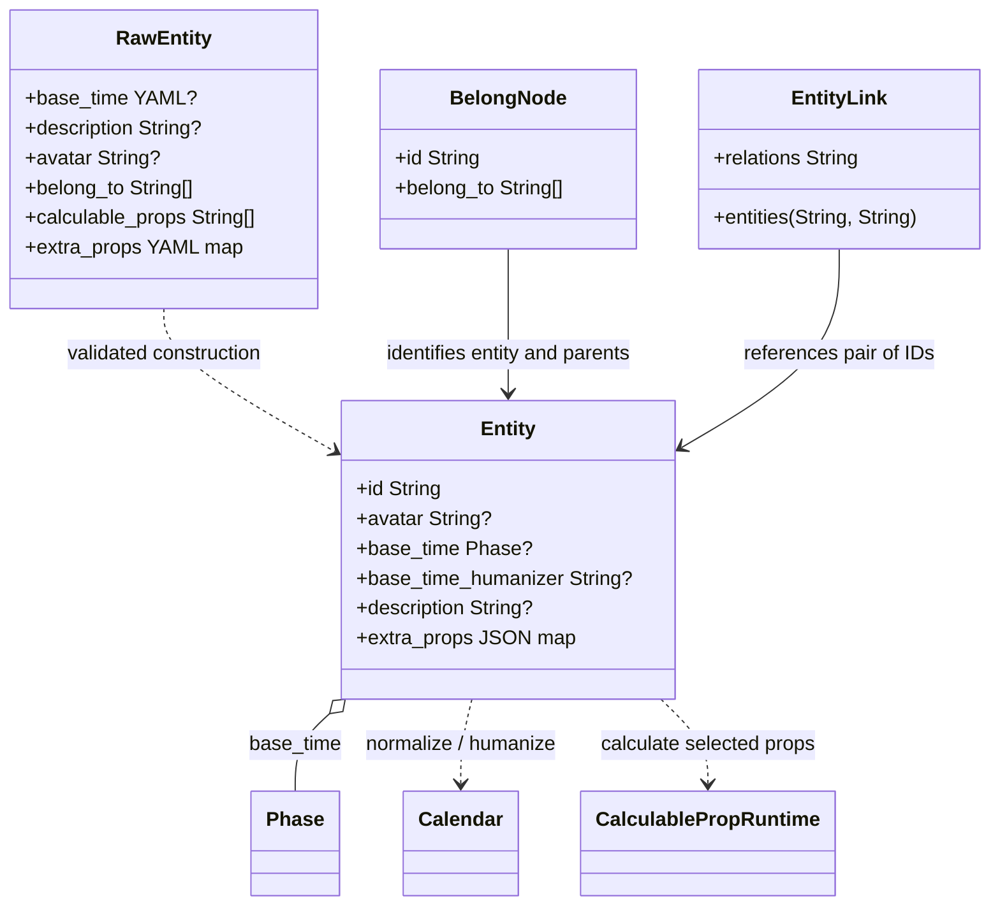
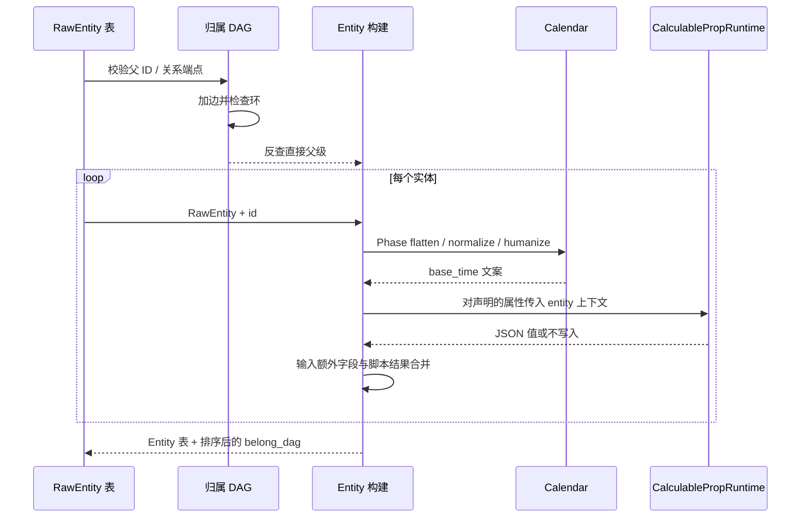

# Entity：实体与关系

`src-tauri/src/weft/entity.rs` 把 YAML 的 `RawEntity` 转成输出用 `Entity`。输入模型保留 `belong_to` 与 `calculable_props` 等构建期字段；运行时 Entity 不包含这些声明，而是包含处理后的头像、基准时间、附加属性。实体归属以单独的 `belong_dag` 输出。

## 构建顺序与归属图

先检查 `belong_to` 与 `entity_link` 中的实体 ID，再以 `belong_to` 建立有向无环图。重复边由图更新操作合并；若形成环，构建失败。图的父边随后反查成每个实体的直接上级列表，排序后写到 `belong_dag`，节点按实体 ID 排序。该数组是输出文档中归属关系的唯一来源。

## 属性合并与引用

非内置键由 Serde 收入 `extra_props` 并转为 JSON。每个声明的计算属性使用注册 ID 查找已加载脚本，输入包括语言、历法路径及实体 ID、归一化基准时间、描述和直接归属 ID。脚本返回 `()` 时不写入；有值时按注册 ID 写进 `extra_props`，覆盖同名输入字段。

`entity_link` 表达关系组和实体 ID 对，当前只做 ID 校验，保持文档层数据原样输出。头像路径相对故事 YAML 所在目录，在构建前验证图片扩展名及文件存在性，输出时解析为绝对路径供前端资源协议读取。
