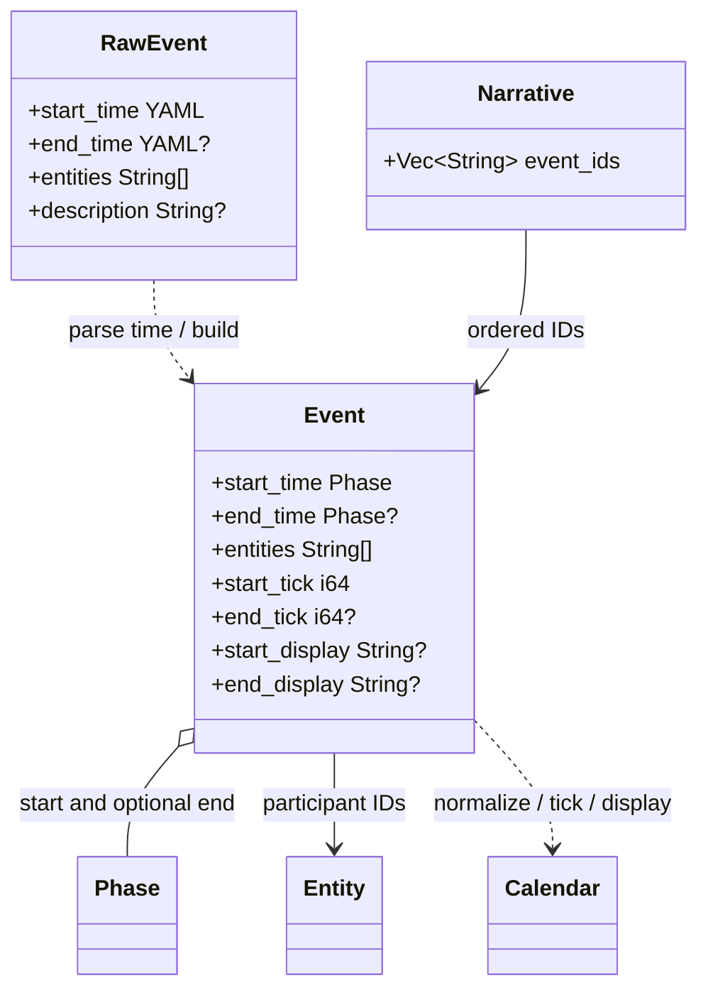
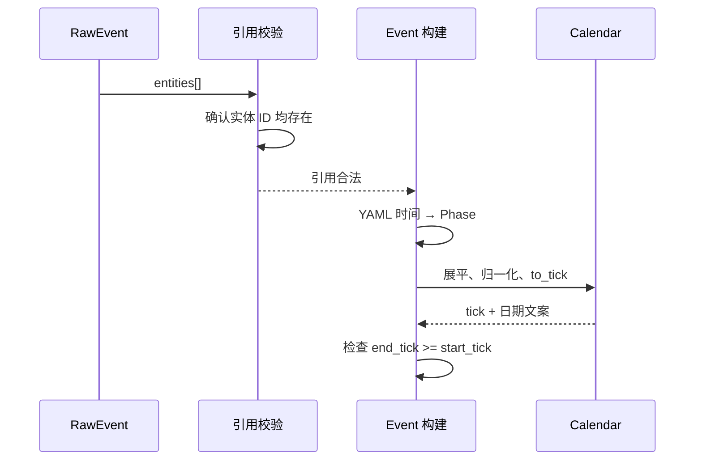

# Event 与 Narrative：事件和叙事线

事件是带时间和参与实体引用的领域对象；叙事线是有序事件 ID 列表。两者在 YAML 输入中先以 Raw 结构保留，校验完成后才成为可输出对象。

## 事件构建

`RawEvent.start_time` 必填；`end_time` 可空。时间共用 Phase 标量兼容及递归数组语法。事件 ID 是组名和标题合成的键。事件参与者必须指向已构建实体；这一轮会汇总并排序所有未知实体引用后统一报告。

实体和事件引用通过后，`build_events` 将 Raw 时间解析为 Phase，先把派生字段留空。后续 `apply_times` 对起止 Phase 分别展平和归一化，调用 `to_tick` 生成刻度，并生成人类可读日期。若结束 tick 早于开始 tick，整份文档解析失败。

## 叙事线

Narrative 保留 YAML 中的事件 ID 顺序，不复制事件内容或重新计算时间。每个 ID 必须存在于 Raw event 表中。前端可以通过 ID 从事件字典解析详情；事件的 tick 由所选 Calendar 统一提供，因此不同事件可在同一故事历法中比较。
