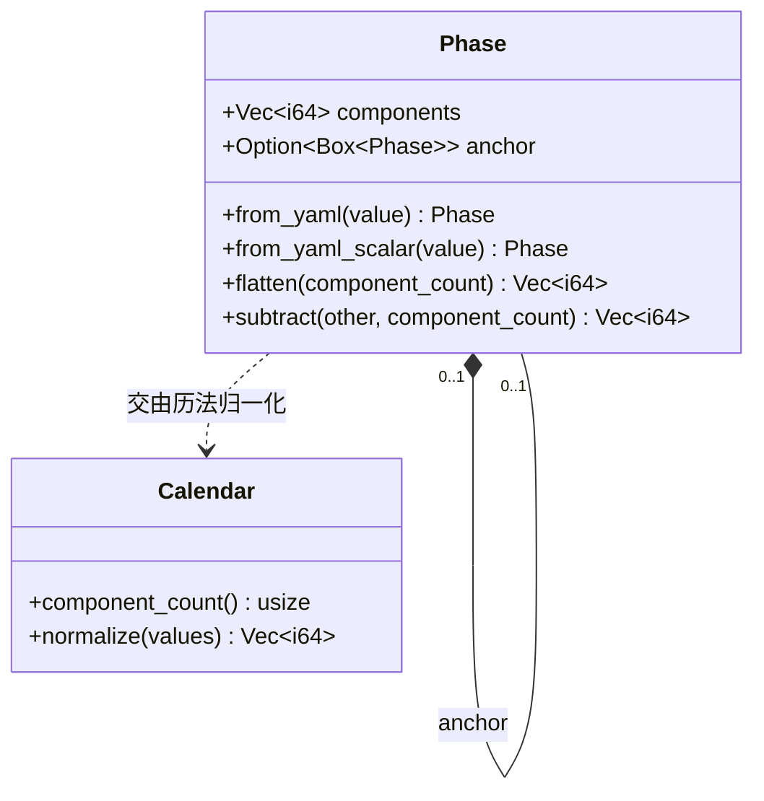
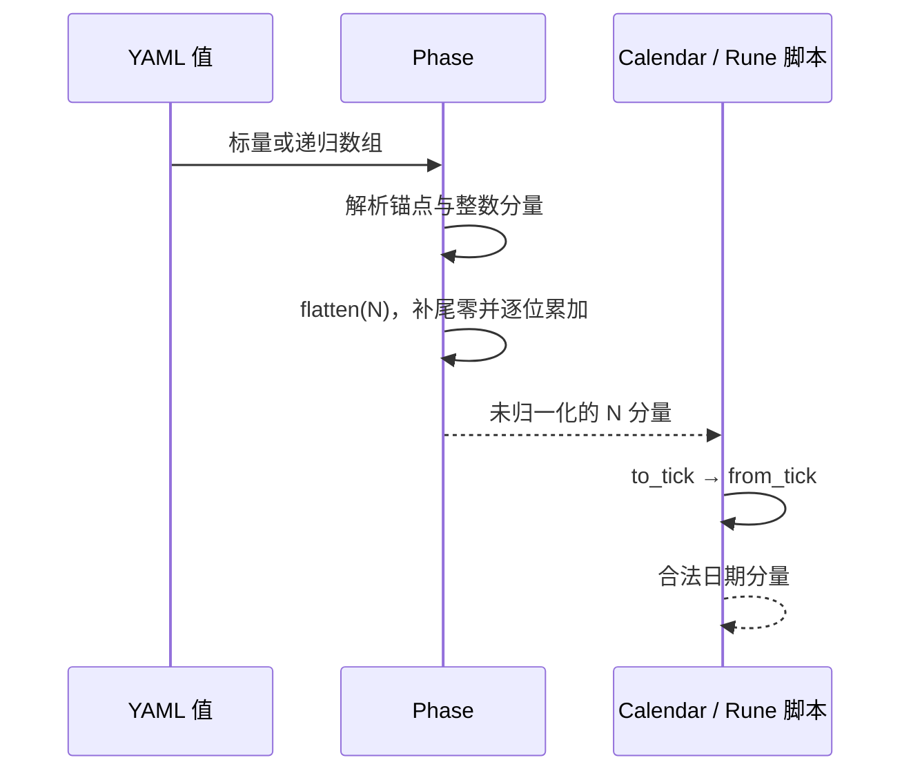

# Phase：时间表达

`Phase` 是 YAML 时间进入运行时后的原始表示，位于 `src-tauri/src/weft/phase.rs`。它把用户输入的时间分量和递归相对偏移保存为一棵小树；该类型不理解年、月、日的长度，也不执行进位或借位。



## 输入形状

时间可以是整数数组，也可以是标量整数。数组的首项若是数组，则该首项递归解析为 `anchor`，剩余整数作为当前层的分量偏移；否则整个数组就是当前层的分量。

```yaml
# 绝对时间
[2025, 4, 2, 10]

# 在锚点上增加 2 小时
[[2025, 4, 2, 10], 0, 0, 0, 2]

# 标量兼容形式，等价于 [42]
42
```

实体 `base_time` 和事件 `start_time` / `end_time` 共用同一解析规则；可选时间字段的缺省或 YAML null 表示没有时间。空列表、非整数分量和不符合结构的值会产生校验错误。

## 展平和溢出

设历法定义的分量个数为 `N`。展平会创建长度为 `N` 的零向量，从最内层锚点到外层逐位累加。少写的尾部分量因此保持为零；任何一层超过 `N` 个分量都会报错。逐次加法使用 checked arithmetic，溢出报 `TimeOffsetOutOfRange`。

例如六分量历法中：

```text
[[2025, 4, 2, 10], 0, 0, 0, 2]
→ [2025, 4, 2, 12, 0, 0]
```

上例只是分量加法。小时超过 23 时仍保留在小时槽位，具体如何进位由历法的 `normalize` 决定。负偏移同样只是分量上的减法。

`subtract` 分别展平两棵 Phase，再对分量做 checked subtraction；不会先将两者归一化。这用于计算实体基准时间之间的差值展示。若历法有非线性分量规则，最终解释仍由 Calendar 处理。

## 责任边界



Phase 负责结构、整数和溢出安全；Calendar 负责日历语义、时间顺序和展示格式。两者分开后，同一种时间表达结构可以用于公历和自定义历法。
